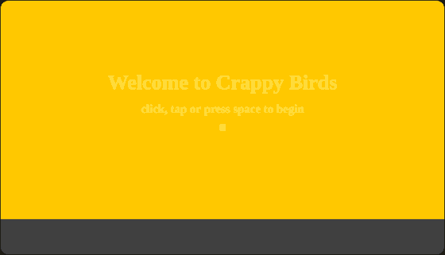
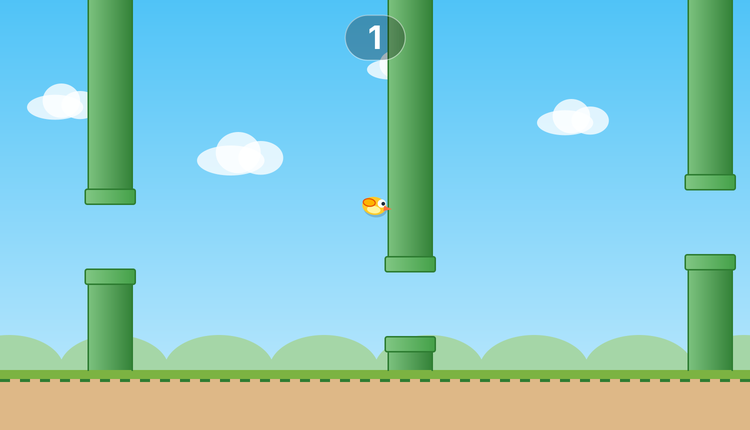
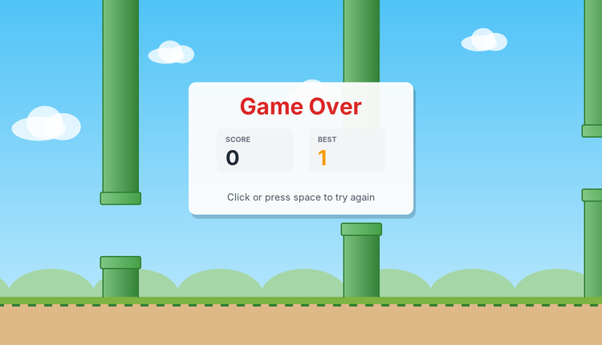

# Crappy Birds

<p align="center">
  <a href="https://amatya27.github.io/CrappyBirds/"></a>
</p>

<p align="center">
  <a href="https://amatya27.github.io/CrappyBirds/"><b>Play it in your browser</b></a> &nbsp;·&nbsp; Java Swing original in <code>src/</code>
</p>

My take on Flappy Bird, written in Java with Swing back in 2020. Pipes keep coming, one click or the space bar flaps you up, and hitting a pipe, the ceiling or the ground ends the run. It keeps your high score for the session.

## How the game works

Everything runs on a 20 ms `javax.swing.Timer` tick:

- **Gravity:** every second tick the downward speed grows by 2, capped at 15.
- **Flap:** a jump cancels any downward speed and pushes the bird up by 10.
- **Columns:** pairs of rectangles move left at 10 px per tick with a gap between them. When a pair leaves the screen, a new one is added 600 px after the last, with a random height.
- **Scoring and collisions:** you score when the bird's center passes a column's center. Collisions use `Rectangle.intersects`, and the bird gets snapped to the edge it hit so it doesn't render inside a column.

<p align="center">
  
  
</p>
<p align="center"><sub>The Java version, running.</sub></p>

## The 2026 refresh

The game logic is unchanged (same 20 ms tick, gravity, flap strength, pipe spacing and hitbox). Everything you see is new, still pure Java 2D:

- **A real bird** instead of a white square, drawn with `Graphics2D` shapes. Its wing flaps, and it tilts with its vertical speed: nose up when rising, nose down when falling.
- **Pipes with caps and shading**, a gradient sky, clouds and hills that scroll at different speeds (parallax), and a moving grass strip.
- **A modern score display:** a glass pill at the top while playing, then a game-over card showing score, best and "NEW BEST!".
- Antialiasing turned on for smooth edges and text.
- Drawing moved into its own `Scene` class, so `FlappyBird` is just game logic.
- **Fixed a bug** where the score kept going up after a crash, because the pipes keep sliding past the dead bird.

## Browser version

`docs/index.html` is a port to an HTML canvas, hosted on GitHub Pages. It draws the same scene as the Java version and keeps the same constants and 20 ms tick (with a fixed-step loop, so it plays at the same speed on any refresh rate). On top of that it:

- scales to any screen size
- works with touch on phones
- remembers your high score between visits

## Running the Java version

You need a JDK (8 or newer).

```bash
javac -d out src/flappybird/*.java
java -cp out flappybird.FlappyBird
```

Or open the folder in NetBeans and run it from there.

**Fixed in 2026:** the source folder is `flappybird`, but two files declared `package flappyBird`. Windows didn't care, but it wouldn't compile on macOS or Linux. Package names now match the folder, and the NetBeans main class points to the right name.

## Files

| File | What it is |
|---|---|
| `src/flappybird/FlappyBird.java` | Game state, physics, input and drawing |
| `src/flappybird/Scene.java` | All the drawing: sky, pipes, bird and score cards |
| `src/flappybird/Renderer.java` | The `JPanel` that calls the game's paint method |
| `src/flappybird/Image.java` | A small splash window built with the NetBeans form editor |
| `docs/index.html` | Browser version |
